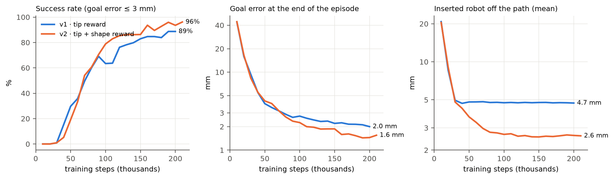
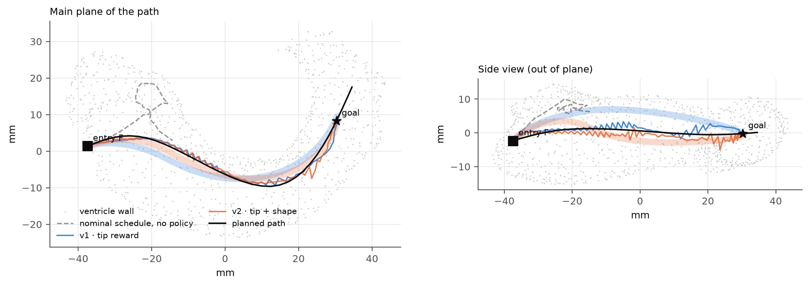

# Soft-robot navigation in the brain ventricles with deep RL (SOFA + PPO)

Simulation scenes and reinforcement-learning code for an MEng project (Biomedical Engineering,
Mahidol University): a two-section pneumatic soft continuum robot enters at Kocher's point and is
steered through the frontal horn of the lateral ventricle to a target 80 mm along a planned path.
A PPO policy controls insertion and bending in a SOFA physics simulation of a patient's ventricle.



**Course submission:** [`submission/`](submission/)
- [notebook](submission/ventricle_rl_ppo.ipynb)
- [2-page summary (PDF)](submission/summary.pdf)
- [environment and reproduction](submission/ENVIRONMENT.md)
- [video script](submission/VIDEO_SCRIPT.md)

## Results (patient 44, right ventricle)

| Policy | Success, 30 test episodes | Goal error, deterministic | Robot body off the path |
|---|---|---|---|
| Nominal curvature schedule, no RL | 0 % | 45.4 mm (wrong branch) | 8.3 mm |
| PPO v1, tip reward | 90 % | 1.2 mm | 4.6 mm |
| PPO v2, tip + body-shape reward | **97 %** | **0.7 mm** | **2.5 mm** |

Success means the robot is fully inserted with a goal error of 3 mm or less. Both policies were
trained for 200k steps (~1 h on 6 CPU cores). Adding the body-to-path term to the reward halves
how far the body strays from the path, and it also makes the tip more accurate.



## Quick start

Reproduce the figures and tables from the saved logs; this does not need SOFA:

```bash
cd submission
pip install -r requirements-analysis.txt
jupyter notebook ventricle_rl_ppo.ipynb
```

Evaluating or retraining the policies needs a SOFA v26.06 build (pixi) and the pinned RL
packages; see [`submission/ENVIRONMENT.md`](submission/ENVIRONMENT.md). The main entry points are:

```bash
rl/run.sh rl/train_ppo.py --name my_run --steps 200000 --envs 5 --w-shape 0.01   # macOS
rl/train_supervised.sh my_run 200000 --envs 5 --w-shape 0.01                      # Linux, crash-safe
rl/run.sh rl/rollout.py --ckpt rl/runs/my_run/final_model.zip --deterministic --out eval.npz
runSofa -l SofaPython3 -g imgui rl/policy_scene.py      # watch a trained policy drive SOFA live
```

## Repository layout

| Path | Contents |
|---|---|
| `cosserat_robot_01_from_matlab.py` | SOFA scene: beam-FEM robot, rigid sheath on the Kocher axis, ventricle wall contact, Yeoh pneumatic actuation |
| `rl/ventricle_env.py` | Gymnasium environment `VentricleNavEnv` (35-value observation, 5-value residual action, reward) |
| `rl/train_ppo.py`, `rl/train_supervised.sh` | PPO training (stable-baselines3) with memory-aware worker respawning and crash recovery |
| `rl/rollout.py`, `rl/summarize.py` | Evaluation rollouts, progress tables |
| `rl/policy_scene.py` | runSofa scene where a trained policy drives the robot |
| `rl/export_web_p44.py`, `rl/export_unity_p44.py`, `rl/export_onnx.py` | Web viewer, Unity and ONNX exports |
| `rl/server/` | Run runSofa on a headless Linux server and view it in a browser (Xvfb + noVNC) |
| `tools/` | Robot design from the patient paths, Kocher pose, ventricle wall preparation, general path |
| `poses/`, `walls/`, `data/` | Patient 44 design cases, collision wall, path, mesh and fiducials |
| `matlab/` | MATLAB Cosserat reference model used to verify the SOFA robot |
| `submission/` | Notebook, summary, environment spec, logs, models, rollouts, figures |

## Data

The patient geometry comes from an MRI-derived dataset of planned paths, ventricle meshes and
Kocher fiducials (40 patients, left and right). Only **patient 44, right side** is included here,
with the data owners' permission. The other patients' data are not distributed.

## Software

SOFA v26.06 (commit `a4d4962a`), SofaPython3, Python 3.12, PyTorch 2.7.1, Stable-Baselines3 2.6.0
and Gymnasium 1.1.1. This repository has no license file yet, so all rights are reserved by the
author until one is added.
